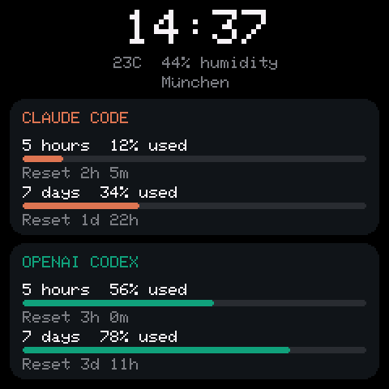
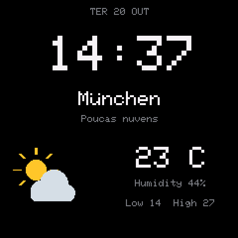
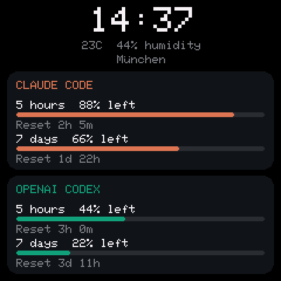

# SmallTV Complete

Open-source firmware for the **GeekMagic SmallTV Ultra (ESP8266, 4 MB, 240 × 240 ST7789)**, bringing clock faces, weather, a five-day forecast and a photo/GIF album together with **Claude Code and OpenAI Codex subscription limits**.

This is a functional replacement for the original GeekMagic feature categories. GeekMagic has not provided its firmware source: this project does not merge or reproduce its proprietary binary, exact artwork, cloud services, or every vendor setting.

**Status: 2.0.1 development preview.** The previous 2.0.0 build is installed and tested on one SmallTV Ultra; the new Settings integration and remaining-limit mode are built and host-tested, awaiting installation approval. Verified Wi-Fi migration from smalltv-ultra-mod 1.0.2, real Claude/Codex pushes, current weather, individual/combined screens, timed rotation, and JPEG/GIF album playback. Tests are limited to this unit; recovery mode and every panel feature have not been exercised on hardware. See [validation details](docs/VALIDATION.md).

 

*Simulator previews with example usage data.*



[Categorized Settings preview](docs/complete/settings-categories.png) · [Phone controls preview](docs/complete/settings-phone.png)

## Choose what the clock displays

- **Integrated Settings:** category submenus use the existing panel design. Open **Settings → Display & screens** for all display controls; `/display` redirects to that same submenu.
- **Used or remaining limits:** the saved switch applies to both providers and all AI faces. Reset countdowns are unchanged; near-exhausted capacity still turns red. The usage API always accepts percentages used.
- **Combined dashboard:** independently show or hide the clock, weather, Claude and Codex meters.
- **One fixed screen:** choose any built-in face, either usage provider, the combined dashboard, or the photo/GIF album.
- **Timed rotation:** tick the screens to cycle through, with a delay of 5–3600 seconds.
- **Photo/GIF album:** advance automatically or hold a selected photo. Upload/crop media in the Photos tab.
- **Classic weather clock:** time, date, city, temperature, humidity and daily low/high, plus an uploaded GIF up to 80 × 80 pixels.
- **German characters:** UTF-8 `Ä Ö Ü ä ö ü ß`, including decomposed umlauts, work in the common bitmap text and vector-font fallback. This adds glyph support; it does not translate the interface into German. Unsupported characters use `?`.

The 13 existing upstream clock/forecast/world faces remain available, alongside the three AI faces and Classic weather clock. Pomodoro timers, brightness scheduling, optional panel password, downloaded faces and the upstream recovery mode remain available. A running focus timer takes priority. Selecting a face in the original gallery switches back to its controls; saving **Settings → Display & screens** reactivates the new display controls. The new rotation list contains built-in faces and the album; downloaded-face rotation uses the upstream controls.

The main panel and its English translations are embedded in the firmware. Optional online face previews/catalogue, city search and weather still require internet access. Automatic upstream firmware update checks are disabled so this fork cannot accidentally install upstream firmware signed by another key.

## Mac companion

Claude Code and Codex must already be installed and signed in on the Mac. The companion uses the Claude Code credential in macOS Keychain and the local Codex `app-server` usage method. It does not send model prompts or make inference calls. Credentials stay on the Mac; only percentages, reset countdowns and plan/status fields go to the clock.

With Python 3.10+ installed, run:

```sh
./macos/install.command 192.168.1.50
```

Replace the example address with the clock's IP. The installer copies the runtime to `~/Library/Application Support/SmallTVUsage`, installs the pinned Python dependency, and enables both LaunchAgents at login. It replaces the two SmallTV service labels it owns. If macOS asks, allow Python to connect to devices on the local network. Keep the Mac awake and on the same reachable network as the clock. The current companion expects no panel password, because its firmware identity probe reads the protected status endpoint. Enabling a panel password requires adding authenticated requests to the companion.

Open **http://127.0.0.1:8787/** on the Mac. Usage refreshes every 60 seconds and is pushed about every 20 seconds. Values expire after five minutes without a successful refresh. Daemon listeners bind only to loopback; HTTP pushes to the clock are local-network traffic. The clock's usage ingestion endpoints are data-only and intentionally unauthenticated, as in the compatible original usage fork; other devices on that network could submit display values. Configuration and firmware updates keep their separate protections.

To run manually instead of installing login services:

```sh
python3 -m venv macos/.venv
macos/.venv/bin/pip install -r macos/requirements.txt
macos/.venv/bin/python macos/usage_service.py --provider claude --device http://192.168.1.50
# In a second terminal:
macos/.venv/bin/python macos/usage_service.py --provider codex --device http://192.168.1.50
```

## Build and test

```sh
python3 -m pip install platformio==6.2.0
node scripts/build-complete-panel.cjs
pio run
sh scripts/test-core.sh
sh scripts/test-renderer.sh
python3 -m pip install -r macos/requirements.txt
python3 -m unittest discover -s tests -p 'test_*.py'
```

Node.js, a C++17 compiler and Python are required. Firmware dependencies are pinned in `platformio.ini`. Output: `.pio/build/smalltv_complete/firmware.bin`. Host tests cover UTF-8, strict usage/display validation, freshness, reset countdowns, timer wraparound, screen rotation and the real drawing code. The renderer checks incremental redraws, transitions and downloadable faces. The original upstream tests and documentation remain in `sim/`, `docs/` and [UPSTREAM.md](UPSTREAM.md).

## Installation, migration and recovery

Only use this build on the **SmallTV Ultra ESP8266**, never an ESP32 SmallTV Pro or another model. Preserve existing files and Wi-Fi settings before changing firmware whenever possible. A public vendor firmware download is a recovery image, not a backup of a device's settings, photos, credentials or exact installed build.

This build uses **4M1M** (LittleFS starts at `0x300000`), matching smalltv-ultra-mod's ESP8266 layout. It does not autoformat that storage. First boot can import Wi-Fi, brightness and timezone from that fork's `/config.json`. This migration was verified from smalltv-ultra-mod 1.0.2 on one device. It does not migrate the original GeekMagic binary's file layout. Do not upload a filesystem image or use an upstream 4M2M build by accident.

From a working compatible unsigned updater, install only after reviewing the model, firmware hash, recovery path and risk of losing access. Later normal updates require the matching separate `.sig` file. Uploading new firmware is an explicit manual action; the Mac companion never flashes anything.

Recovery inherited from upstream: power-cycle three times, keeping each boot under 30 seconds. Join the recovery Wi-Fi shown on the screen and open `http://192.168.4.1/`; physical recovery mode accepts an unsigned image. Recovery is useful only if the bootloader/application can still run. If it cannot, a **3.3 V USB-to-serial adapter connected inside the case** is required. The device's USB power cable does not provide serial recovery.

### Signing updates

This fork has its own RSA-2048 public update key in `smalltv-pomodoro/ota-public.pem`. Its private key is not in this repository. Never append a signature to a firmware image; it must remain a separate file.

```sh
SMALLTV_SIGNING_KEY=/secure/path/ota-private.pem node scripts/assinar.cjs sign .pio/build/smalltv_complete/firmware.bin
node scripts/assinar.cjs verify .pio/build/smalltv_complete/firmware.bin
```

If building your own fork, generate your own RSA-2048 pair **before the first installation**, replace the public PEM, and run `node scripts/assinar.cjs header`. Keep your private key securely: normal OTA updates must be signed with the key trusted by the installed firmware. The optional workflow template in `docs/ci/firmware.yml` compiles unsigned development artifacts only. To enable it, place it in `.github/workflows/firmware.yml` using a GitHub sign-in authorized to publish workflows. It is supplied as a template because the current publishing sign-in has repository access without the additional workflow scope.

## Credits and license

Based on [davicorrea0/smalltv-pomodoro](https://github.com/davicorrea0/smalltv-pomodoro), commit `13c1bc6ad934faab639e8c15c63e47eed1b2ba1b`, under **GPL-3.0**. Its original source, history, assets and bundled dependency licenses are preserved. See [LICENSE](LICENSE), `licenses/` and [UPSTREAM.md](UPSTREAM.md).

The API contract is compatible with [msdxlab/SmallTV-ultra-mod](https://github.com/msdxlab/SmallTV-ultra-mod). Mac readers are copied from [giovi321/clawdmeter-daemon](https://github.com/giovi321/clawdmeter-daemon), commit `f4cf5c6fe03f3cdbc60f540b7110015ad1c00792`, under WTFPL; their license is in `macos/readers/LICENSE`. GeekMagic, Anthropic and OpenAI do not endorse this project.
